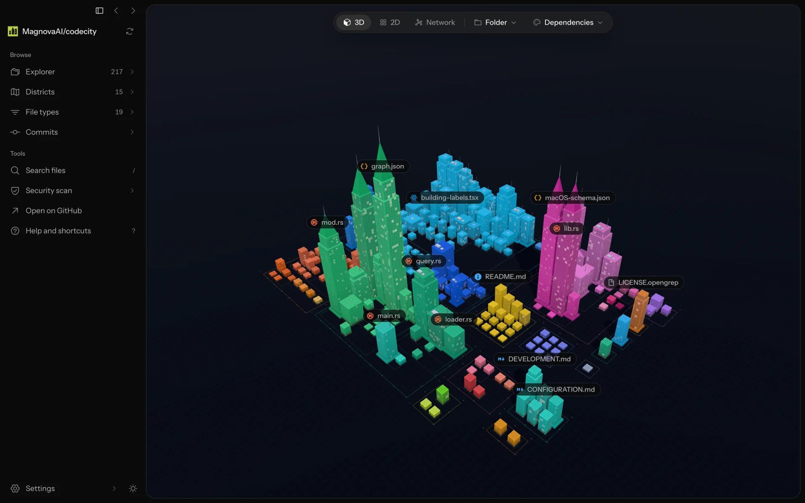
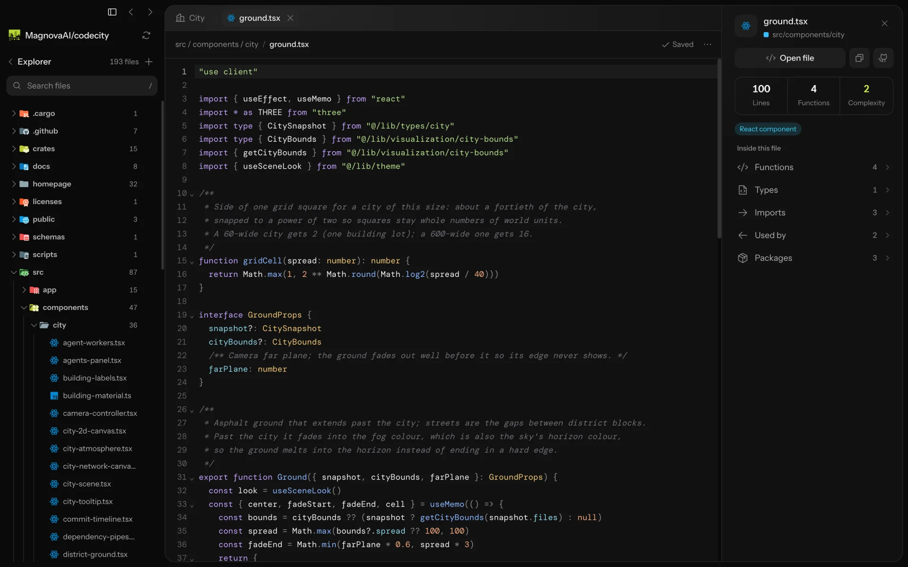
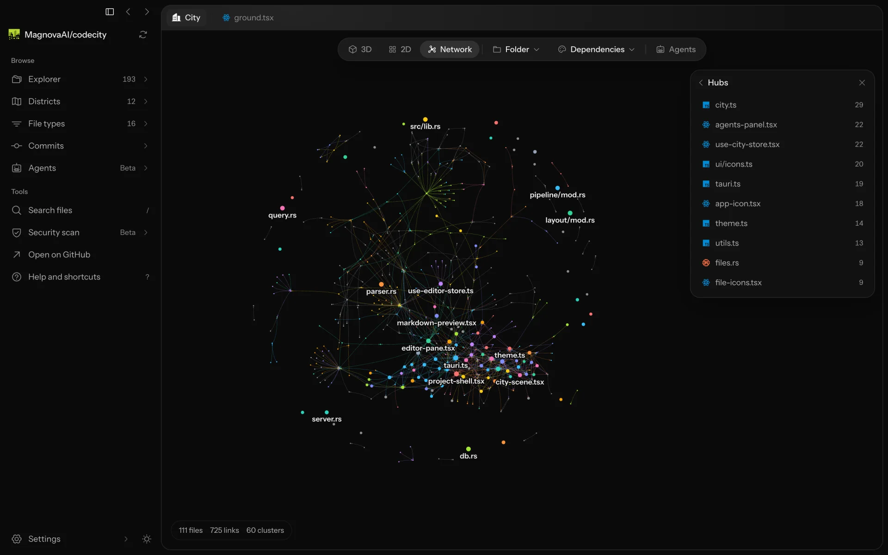
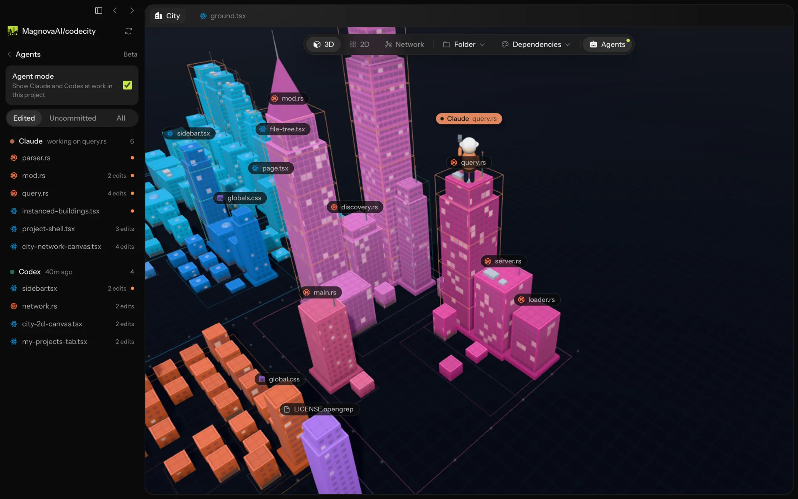
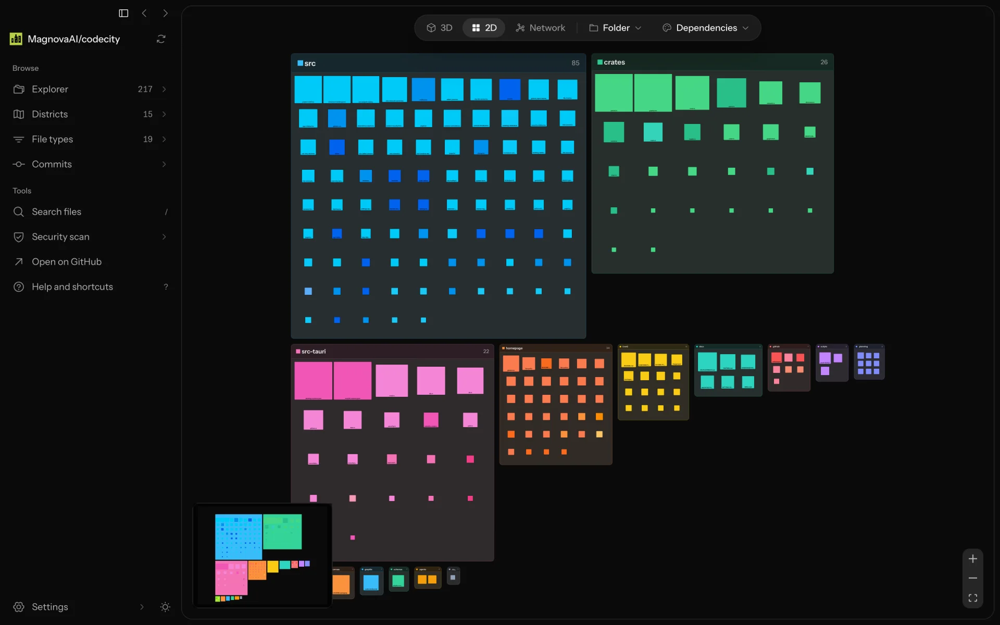
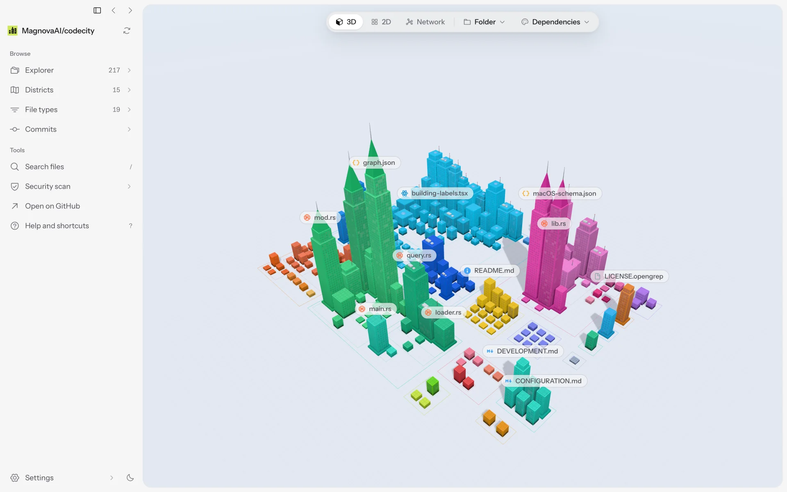

<div align="center">
  
  <h1>CodeCity</h1>
  <p><strong>A visual tool for your codebase.</strong></p>
  <p>See its shape as a 3D city, discover how its files connect, and read any file in the built-in viewer.<br />A desktop app, a CLI and an MCP server on one Rust analysis engine.</p>

  <p>
    <a href="LICENSE"></a>
    
    <a href="https://github.com/omkarbhad/codecity/actions/workflows/ci.yml"></a>
    
  </p>

  <p>
    <a href="#quick-start">Quick start</a>&nbsp;&nbsp;&nbsp;
    <a href="docs/GETTING-STARTED.md">Getting started</a>&nbsp;&nbsp;&nbsp;
    <a href="docs/ARCHITECTURE.md">Architecture</a>&nbsp;&nbsp;&nbsp;
    <a href="CONTRIBUTING.md">Contributing</a>
  </p>
</div>



## What it does

- **Shows the shape of the code.** Every file is a building: its height is its line count and its footprint grows with its functions. Folders are districts with streets between them. The same city is also a flat 2D map.
- **Shows how files connect.** The network view draws every import and call, labels the best connected files, and lists entry points, hubs and clusters. Trace from an entry point to see everything it reaches.
- **Opens the files.** Pick a building to see its functions, types, imports and what imports it, then read or edit the source in the built-in file viewer.
- **Answers a question with colour.** Switch between dependencies, complexity, unused exports, file size and type count.
- **Shows coding agents at work (beta).** Agent mode puts a builder on the file Claude Code or Codex is editing, and lists what each agent edited and which edits are not committed yet. It reads only local session logs and git.
- **Scans for security findings (beta)** with opengrep.
- **Works on local folders and GitHub repositories**, and serves the same snapshot to agents over MCP and to scripts as JSON.

The full list is in [docs/FEATURES.md](docs/FEATURES.md).

| File viewer | Network |
| --- | --- |
|  |  |

| Agent mode | 2D map | Light theme |
| --- | --- | --- |
|  |  |  |

## Quick start

You need Node.js 20.9 or newer, pnpm 9.15 and stable Rust. The desktop app also needs the
[Tauri 2 system libraries](https://v2.tauri.app/start/prerequisites/); the CLI and MCP server need Rust alone.

```bash
git clone https://github.com/omkarbhad/codecity.git
cd codecity
pnpm install
pnpm desktop
```

`pnpm desktop` opens the app. Choose a local folder or paste a Git URL, and the city is built from it.

<details>
<summary><strong>Setting up from scratch on macOS</strong></summary>

1. Install the Xcode command line tools (compiler and linker):

   ```bash
   xcode-select --install
   ```

2. Install Homebrew if you do not have it, then Node.js and Rust:

   ```bash
   /bin/bash -c "$(curl -fsSL https://raw.githubusercontent.com/Homebrew/install/HEAD/install.sh)"
   brew install node
   curl --proto '=https' --tlsv1.2 -sSf https://sh.rustup.rs | sh -s -- -y
   source "$HOME/.cargo/env"
   ```

3. Turn on pnpm through Corepack (it ships with Node.js):

   ```bash
   corepack enable
   corepack prepare pnpm@9.15.0 --activate
   ```

4. Clone the repository and install packages:

   ```bash
   git clone https://github.com/omkarbhad/codecity.git
   cd codecity
   pnpm install
   ```

5. Start the desktop app in development mode:

   ```bash
   pnpm desktop
   ```

</details>

<details>
<summary><strong>Setting up from scratch on Windows (PowerShell)</strong></summary>

1. Install the **Microsoft C++ Build Tools** with the "Desktop development with C++" workload, and
   the **WebView2 runtime** (already present on Windows 11). Both are listed on the
   [Tauri prerequisites page](https://v2.tauri.app/start/prerequisites/). With winget:

   ```powershell
   winget install --id Microsoft.VisualStudio.2022.BuildTools --override "--wait --passive --add Microsoft.VisualStudio.Workload.VCTools --includeRecommended"
   winget install --id Microsoft.EdgeWebView2Runtime
   ```

2. Install Node.js, Rust and Git, then open a **new** PowerShell window so they are on your `PATH`:

   ```powershell
   winget install --id OpenJS.NodeJS.LTS
   winget install --id Rustlang.Rustup
   winget install --id Git.Git
   ```

3. Turn on pnpm through Corepack (run PowerShell as Administrator for this one step):

   ```powershell
   corepack enable
   corepack prepare pnpm@9.15.0 --activate
   ```

4. Clone the repository and install packages:

   ```powershell
   git clone https://github.com/omkarbhad/codecity.git
   cd codecity
   pnpm install
   ```

5. Start the desktop app in development mode:

   ```powershell
   pnpm desktop
   ```

The same `pnpm` and `cargo` commands work in Command Prompt (`cmd.exe`). Use `copy` instead of
`cp` and backslashes in paths, for example `.\target\release\codecity-cli.exe`.

</details>

<details>
<summary><strong>Setting up from scratch on Linux</strong></summary>

Install the WebKitGTK and build packages from the
[Tauri prerequisites page](https://v2.tauri.app/start/prerequisites/#linux) for your distribution,
then follow the macOS steps from step 2 with your package manager in place of Homebrew.

</details>

No environment variables are required. `.env.example` lists two optional development switches
(`CODECITY_TIMING`, `CODECITY_MCP_NO_CACHE`).

## Verify a download

Every release file is attested by GitHub, a signed record that it was built from this repository by the
release workflow. With the [GitHub CLI](https://cli.github.com/):

```bash
gh attestation verify CodeCity_0.1.2_universal.dmg --repo omkarbhad/codecity
```

This checks that a file is genuine and unaltered. It does not remove the macOS or Windows warning about an
unsigned app; that needs a paid certificate.

## Command line

Build the CLI once, then point it at a project:

```bash
cargo build -p codecity-cli --release
./target/release/codecity-cli analyze /path/to/your/repo
```

```bash
# The full snapshot as JSON
codecity-cli analyze ./my-project --json -o snapshot.json

# One file from a saved snapshot
codecity-cli inspect snapshot.json --node src/lib/foo.ts

# Import network only
codecity-cli network ./my-project --communities
codecity-cli network ./my-project --entries
codecity-cli network ./my-project --hubs
```

| Flag | What it does |
| --- | --- |
| `--json`, `-o <file>` | Write the full `CitySnapshot` as JSON instead of a summary |
| `--timeout <secs>` | Stop if the analysis takes longer (default `60`, `0` turns it off) |
| `--no-gitskip` | Include files that `.gitignore` hides |
| `--exclude '<glob>'` | Leave out extra paths (repeatable, gitignore-style) |

On Windows the binary is `.\target\release\codecity-cli.exe`.

## MCP server

`codecity-mcp` gives an LLM agent the same snapshot over stdio:

```bash
# Analyze a repository on startup
codecity-mcp --repo /path/to/repo

# Or load a snapshot written by the CLI
codecity-mcp --snapshot snapshot.json --source-root /path/to/repo
```

It speaks JSON-RPC on stdout and logs to stderr. From a checkout, run it with
`cargo run -p codecity-mcp -- --repo /path/to/your/repo`.

## Supported languages

Parsed with tree-sitter: TypeScript, JavaScript, Python, Rust, Go, Java, C, C++, C#, Ruby, PHP, Swift, Kotlin, Bash, Zig, Lua, Haskell, Dart, Elixir, Scala, R, Julia, Perl, Erlang, Dockerfile, Nix, GLSL, Make, OCaml, WGSL, Groovy, GraphQL, Emacs Lisp, HCL, Protobuf, CSS, HTML, JSON, YAML, Markdown, TOML.

## Repository layout

```
codecity/
├─ src/                  Desktop app frontend (Next.js 16, React 19)
├─ src-tauri/            Desktop shell (Tauri 2, Rust): database, GitHub, file access
├─ crates/
│  ├─ codecity-core/     Analysis engine: parsing, import resolution, layout, network
│  ├─ codecity-cli/      The `codecity-cli` binary
│  └─ codecity-mcp/      The `codecity-mcp` binary (MCP over stdio)
├─ homepage/             Marketing site (Astro)
├─ docs/                 Guides and architecture notes
├─ public/               App icons, fonts and brand files
├─ scripts/              Maintenance scripts
└─ licenses/             Third-party licence notices
```

All four programs sit on `codecity-core`, which does no I/O of its own.

## Development

| Command | What it does |
| --- | --- |
| `pnpm desktop` | The full desktop app in development mode |
| `pnpm dev` | The frontend alone, at <http://localhost:3000> |
| `pnpm type-check` | `tsc --noEmit` |
| `pnpm build:desktop` | A debug desktop build, not bundled |
| `pnpm bundle:desktop` | The desktop bundle for distribution |
| `cargo test -p codecity-core` | The analysis engine's tests |
| `pnpm dev:homepage` | The marketing site, on port 3001 |

More in the docs:

- [Getting started](docs/GETTING-STARTED.md): install, first run, common setup problems
- [Development](docs/DEVELOPMENT.md): build commands, adding a language or an RPC command
- [Architecture](docs/ARCHITECTURE.md): how the crates and the frontend fit together
- [Configuration](docs/CONFIGURATION.md) and [testing](docs/TESTING.md)
- [Features](docs/FEATURES.md) and [roadmap](docs/ROADMAP.md)

## Built with

- **Frontend:** Next.js 16, React 19, TypeScript, Tailwind CSS 4, Zustand, TanStack Query, Radix UI, Phosphor icons
- **3D:** three.js with `@react-three/fiber` and `@react-three/drei`
- **Desktop shell:** Tauri 2
- **Storage:** SQLite through `rusqlite`
- **Analysis:** tree-sitter grammars, `rayon` for parallel parsing, `ignore` and `globset` for walking files
- **MCP:** `rmcp`, the official Rust SDK
- **Security scan:** `opengrep`, bundled as a sidecar (see `licenses/LICENSE.opengrep`)

## Contributing

Issues and pull requests are welcome. Read [CONTRIBUTING.md](CONTRIBUTING.md) and the
[code of conduct](CODE_OF_CONDUCT.md) first. Report security problems privately, as described in
[SECURITY.md](SECURITY.md).

## License

[PolyForm Noncommercial License 1.0.0](LICENSE). The source is public and free to use for personal, research, educational and
nonprofit purposes. Commercial use, including using it in a business or selling it or a service built on it, is not
allowed. Versions up to and including 0.1.2 were published under the MIT License and stay under it.
