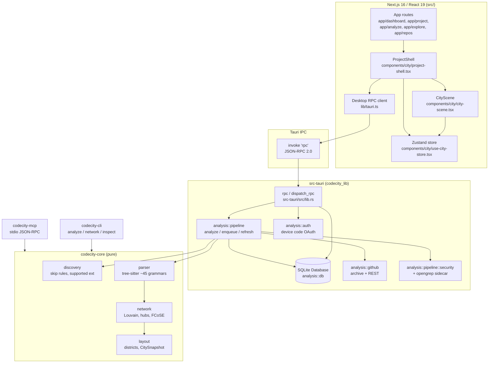

<!-- generated-by: gsd-doc-writer -->
# Architecture

## System overview

CodeCity is a Tauri 2 desktop application that visualizes a codebase as an interactive 3D city.
Given a local directory or a GitHub repository, the Rust backend walks the corpus, parses every
supported source file with tree-sitter, resolves imports, runs network analysis (Louvain
communities, entry points, hubs) and a spatial layout, then persists the result as a
`CitySnapshot`. The Next.js / React 19 frontend reads that snapshot over JSON-RPC and renders it
with `@react-three/fiber`. A separate `codecity-mcp` binary exposes the same snapshot data to LLM
agents over stdio. The architecture is a layered pipeline (ingest → parse → resolve → network →
layout → persist) sitting underneath a thin RPC dispatch layer and a renderer.

## Component diagram



## Data flow

A typical "analyze a repo and render it" request flows as follows. References are concrete and
discoverable in the source tree.

1. **User triggers analysis.** The frontend (an `app/analyze` page or the dashboard) calls
   `enqueueAnalysis` in `src/lib/tauri.ts`, which wraps `invoke("rpc", …)`
   with a JSON-RPC 2.0 envelope.
2. **Tauri command dispatch.** `src-tauri/src/lib.rs::rpc` parses the envelope and routes via
   `dispatch_rpc` (lib.rs:187). Methods include `analysis.analyze`, `analysis.enqueue`,
   `analysis.refresh`, `analysis.recomputeSnapshot`, `analysis.parseFile`, `analysis.analyzeCode`,
   `projects.*`, `git.*`, `github.*`, `user.current`, and `security.*`.
3. **Pipeline orchestration.** `analysis::pipeline::analyze` (src-tauri/src/analysis/pipeline/mod.rs)
   auto-detects whether the input is a GitHub URL or a local path. For GitHub input it calls
   `download_or_clone_repo`, which first tries the zipball endpoint
   (`https://api.github.com/repos/{owner}/{repo}/zipball/HEAD`) and falls back to a shallow
   `git clone --depth 1`. Repos are cached under `dirs::data_dir()/codecity/repos/{owner}-{repo}`.
4. **Source discovery.** `collect_source_files` and `collect_source_tree_entries` walk the
   directory using rules from `codecity_core::discovery` (skip lists: `node_modules`, `.git`,
   `dist`, `.next`, `build`, `target`, `__pycache__`, `vendor`, `.venv`, lockfiles, etc.).
5. **Parse phase.** Files are grouped by top-level folder and parsed in batches by
   `codecity_core::parser::parse_file_batch`. Tree-sitter grammars cover ~45 languages (declared
   in workspace `Cargo.toml`: TypeScript, JavaScript, Python, Rust, Go, Java, C, C++, Ruby, PHP,
   Swift, Kotlin, Bash, Zig, Lua, Haskell, Dart, Elixir, Scala, R, Julia, Perl, C#, Erlang,
   Dockerfile, Nix, GLSL, Make, OCaml, WGSL, Groovy, GraphQL, Elisp, HCL, Proto, and more).
   Each `ParsedFile` records functions, classes, types, imports, decorators, complexity, and
   call sites.
6. **Import resolution.** `parser::resolve_internal_imports_full` cross-references imports
   against the global file index, using `TsConfigAliases` (built from `tsconfig*.json` /
   `jsconfig.json`) and `ZigDeps` (built from `build.zig.zon`) to resolve aliased paths.
7. **Network + layout.** `codecity_core::layout::create_snapshot_with_mode_and_source_tree`
   invokes `network::compute_network_analysis` (Louvain communities, top entry points, top hubs,
   FCoSE coordinates) and produces the `CitySnapshot` (districts, file positions, network nodes
   and edges, stats, source tree).
8. **Persistence.** `analysis::db::Database` saves parsed files (`save_parsed_files`) and the
   snapshot (`save_snapshot`) to SQLite. Progress is reported continuously via
   `db.update_project_progress`.
9. **Frontend render.** When the snapshot is ready the frontend calls `projects.getSnapshot`,
   hydrates the Zustand store (`use-city-store.tsx`), and `CityScene` renders the 3D city:
   `Ground`, `DistrictGround`, `DistrictLabels`, `InstancedBuildings`, `DependencyPipes`,
   `CameraController`, `BuildingLabels`, `SelectionMarker`. Layout / filter changes call
   `analysis.recomputeSnapshot` to re-derive positions without re-parsing.

A parallel flow exists for security scans: the frontend calls `security.scan`, the backend
inserts a scan row, spawns the bundled `opengrep` sidecar via `tokio::process::Command`, parses
its JSON output into `FindingRecord`s, and the frontend polls `security.get` every 2 s
(`src/lib/security.ts::pollSecurityScan`) until the scan reaches `COMPLETED`, `FAILED`, or
`CANCELLED`.

## Key abstractions

- `CitySnapshot` — `crates/codecity-core/src/layout/mod.rs`. The canonical data contract:
  districts, sub-districts, per-file `FileData` (position, complexity, in/out degree, community,
  symbols, imports), network nodes and edges, communities, entry points, hubs, source tree, and
  stats. Serialized to JSON, persisted to SQLite, replayed to the frontend.
- `ParsedFile` — `crates/codecity-core/src/parser.rs`. Per-file output of the tree-sitter pass:
  functions, classes, types, symbols, imports, external imports, decorators, complexity, call
  sites, frontend framework markers. Pre-layout structure.
- `AnalysisParser` — `crates/codecity-core/src/parser.rs`. Owns the tree-sitter `Parser`
  instances; `parse_file` and `parse_file_batch` (rayon-parallel) are the public entry points.
- `Database` — `src-tauri/src/analysis/db.rs`. Mutex-wrapped `rusqlite::Connection`. Owns
  schema, projects, parsed files, snapshots, settings (GitHub token), security scans, and
  findings.
- `dispatch_rpc` — `src-tauri/src/lib.rs:187`. Single function that maps every JSON-RPC method
  name to an `analysis::*` or `db::*` call. The frontend's entire backend contract lives here.
- `AppState` — `src-tauri/src/lib.rs:12`. Tauri-managed state holding the `Database` and the
  `AppHandle`. Injected into RPC handlers via `tauri::State`.
- `useCityStore` — `src/components/city/use-city-store.tsx`. Zustand store holding selection,
  hover, visualization mode (`dependencies`, `complexity`, `unused`, `filesize`, `types`), view
  dimension (`2d`, `3d`, `network`), filters, and panel state. Single source of truth for the
  scene.
- `CodecityMcp` — `crates/codecity-mcp/src/server.rs`. MCP server exposing graphify-style
  primitives (`overview`, `explain`, `find_path`, `find_callers`, `find_callees`,
  `entry_points`, `hubs`) over stdio via `rmcp`.

## Directory structure rationale

The repo is a Cargo workspace + a Next.js app sharing a single tree. Top-level layout:

```
codecity/
├── Cargo.toml              # Workspace root: pins shared deps (tree-sitter family, serde, rmcp)
├── package.json            # pnpm workspace root for the Next.js frontend
├── crates/
│   ├── codecity-core/      # Pure analysis library — zero I/O, zero app deps.
│   │                       # Reused by src-tauri, codecity-cli, and codecity-mcp.
│   │                       # Modules: discovery, parser, network, layout.
│   ├── codecity-cli/       # Thin CLI wrapper: `codecity analyze | network | inspect`.
│   └── codecity-mcp/       # MCP server exposing CitySnapshot queries over stdio (rmcp).
├── src-tauri/              # Desktop app crate. Owns SQLite, HTTP, OAuth, RPC, security scans.
│   ├── src/
│   │   ├── main.rs         # Boot: `codecity_lib::run()`.
│   │   ├── lib.rs          # Tauri builder, AppState, JSON-RPC dispatcher.
│   │   └── analysis/       # App-layer wrappers around codecity-core.
│   │       ├── auth.rs     # GitHub device-code OAuth + `gh` CLI session import.
│   │       ├── db.rs       # rusqlite Database (projects, snapshots, scans, settings).
│   │       ├── github.rs   # GitHub REST helpers (repos, commits, file content).
│   │       └── pipeline/   # Orchestration: analyze, enqueue, refresh, security scan.
│   ├── binaries/           # Sidecar binaries (opengrep, target-triple suffixed).
│   ├── capabilities/       # Tauri 2 capability manifests.
│   └── tauri.conf.json     # Bundle, window, plugin, updater, sidecar config.
├── src/                    # Next.js frontend (App Router).
│   ├── app/                # Routes: dashboard, project, analyze, explore, repos.
│   ├── components/
│   │   ├── city/           # 3D city scene + panels. Renders the snapshot.
│   │   ├── dashboard/      # Sidebar, project list, GitHub repos, new-analysis dialog.
│   │   └── ui/             # Shared low-level UI primitives.
│   ├── hooks/              # use-mobile, use-scroll.
│   └── lib/
│       ├── tauri.ts        # JSON-RPC client (single `invoke("rpc", …)` entry).
│       ├── security.ts     # Security scan polling helper.
│       ├── app-updater.ts  # Tauri updater glue.
│       ├── types/city.ts   # TS mirror of CitySnapshot.
│       └── visualization/  # Building dimensions, city bounds, color utilities.
├── homepage/               # Separate Next.js project for the marketing site.
├── schemas/                # YAML data contracts for snapshot / network.
├── licenses/               # Third-party license notices bundled with the app.
├── scripts/                # Build / packaging helpers.
└── docs/                   # Project documentation (this file lives here).
```

The split is deliberate: `codecity-core` is the analysis engine — pure, deterministic, free of
HTTP/DB/Tauri. `src-tauri` adds the desktop concerns (persistence, network, IPC, sidecars).
`codecity-cli` and `codecity-mcp` reuse `codecity-core` directly without inheriting any desktop
baggage, which is what keeps the engine shippable as a GitHub Action, a CLI, or an MCP server
without forking.
